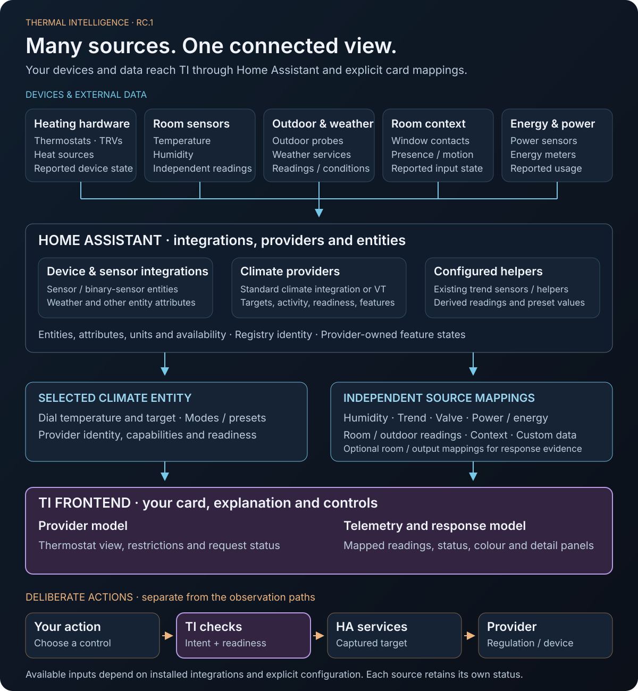

# Thermal Intelligence architecture contract

The standalone frontend is prepared as a release candidate on `develop`; the last beta remains on `senyo888-patch-1`. It presents Home Assistant/provider state and sends commands only after explicit user interaction. The optional backend and additional cards remain planned.

## Ownership and layers

[Open the full-size graph](assets/presentation/ti-ownership.svg).

Thermostats and TRVs are one part of the input landscape. Independent indoor sensors, outdoor probes, weather services, window contacts, presence/motion sensors and power/energy meters can also contribute observations through their Home Assistant integrations. Available inputs depend on the installed integrations and explicit configuration.

| Layer | Responsibility |
| --- | --- |
| **Devices and external data** | Physical measurements, device reports, outdoor readings, weather conditions and metered usage |
| **Home Assistant integrations and helpers** | Expose entities, attributes, units and availability; provide climate services, registry identity and any configured derived readings |
| **Thermostat provider, such as VT** | Regulation, schedules, lock policy and accepted feature states; reads its own configured inputs |
| **TI frontend** | Read the selected climate entity and independent source mappings, explain their status, and validate requests from explicit user actions |

### Two observation paths

The **selected climate entity** supplies the dial’s current temperature and target, advertised controls and provider details. The **independent source mappings** supply optional humidity, temperature trend, valve position, power, energy and named readings. Those sensors do not have to pass through VT. Existing HA trend sensors/helpers supply the trend; TI reads that configured result.

An independent room or TRV temperature can be a named reading or an explicitly mapped response-arc input. The dial continues to use the selected climate entity’s `current_temperature`. Outdoor readings and weather conditions can be explicit scalar feature/custom-telemetry mappings; forecast processing and weather-driven heating policy belong to separate provider/backend contracts.

Raw window, presence and motion inputs remain distinct from the feature states accepted by VT. TI preserves which source a reading came from, its availability, units and any configured freshness requirement. [Configuration and mapping reference](docs/card-configuration.md).

### Explicit actions and future components

Rendering, setup and reconnects read state. A command starts with explicit user intent and a captured target, then passes capability and readiness checks before calling the supported Home Assistant service. Displaying a sensor gives it no control authority.

Regulation and house policy stay with the configured provider/backend, independently of the card. The planned TI backend sits outside this RC.1 frontend boundary; its future contracts must define deterministic decisions, ownership, persistence and failure behaviour.

## Evidence model

Keep HVAC mode, preset, control ownership and activity as separate fields. Each optional datum needs a source and status; where relevant also units, timestamp/freshness, provider/schema version and whether it is measured, estimated or reported. Do not use arbitrary freshness timeouts to make stable values appear stale: establish provider-appropriate freshness semantics.

Distinguish unsupported, disabled/unconfigured, expected-but-unavailable, unknown, stale, invalid and available. Missing humidity must not disable valid temperature control. Missing readiness for a known readiness-gated provider must disable dependent writes. Unknown readiness must not trigger fallback to a less restrictive adapter.

Standard adapters derive capabilities from verified HA state, supported features, modes and services. Provider selection uses registry identity or explicit configuration. Do not recognise VT by entity name, infer manual ownership from preset `none`, or infer Comfort from a target temperature. Preserve manual schedules and provider-specific Frost mapping.

Activity can include demand, service dispatch, integration-reported `hvac_action` and physical-device observation as separate evidence. An observed valve opening does not prove heat transfer; successful dispatch and state convergence do not prove physical response or causal confirmation.

## Command contract

1. Capture the explicit target entity/provider/action and values at user intent.
2. Validate capability, range, units, step, readiness, connection and applicable provider restrictions.
3. Dispatch only a supported service to that captured target. A subsequent entity selection cannot retarget an in-flight request.
4. Track dispatch result separately from observed state. Bound pending state and expose uncertainty/timeouts honestly.
5. Reconcile fresh provider evidence without replaying requests on reconnect, render, resource reload or editor reopening.

Define coalescing/cancellation behavior for rapid inputs and stale completions. UI pending state does not lock out an authoritative backend writer. Concurrent changes need visible reconciliation, not repeated corrective commands. Configuration saves affect card configuration only; no incidental heating call.

## Configuration and editor

Use a versioned, validated card configuration with documented migrations. All declared first-release options must be available visually, including optional telemetry/provider details where retained. Preserve unknown/advanced fields during edits. Scope settings to a card instance unless the user explicitly selects a broader operation.

Separate a no-entity setup state from operational validation. Stub generation, editor construction and preview have no device side effects. Escape dynamic text at DOM sinks. No unsafe HTML from entities, provider reason text or imported config. The prerelease registers only `thermal-intelligence-beta-card` and its editor, preserving legacy registrations. Guard duplicate resource loading without masking incompatible versions; see [migration](docs/migration.md).

## Optional Humidity Intelligence interoperability

HI remains the authority for its seasonal humidity targets, Stability, selected lanes and reasons. TI may display an explicit supported HI contract with attribution; it must not reconstruct those semantics, add HI commands, or require HI installation. Local TI humidity colours are presentation preferences with separate labels.

## Code and documentation

The frontend separates `src/cards/`, `src/editor/`, `src/providers/`, `src/model/` and `src/commands/`. Synthetic fixtures and unit/browser tests live under `tests/`. The reproducible module is `dist/thermal-intelligence.js`.

The README introduces the product; the Wiki provides practical guidance; repository documents define configuration, compatibility and technical contracts. The website presents the same supported features and prerelease limits. See [distribution](docs/distribution.md) and [command contracts](docs/command-contract.md).
