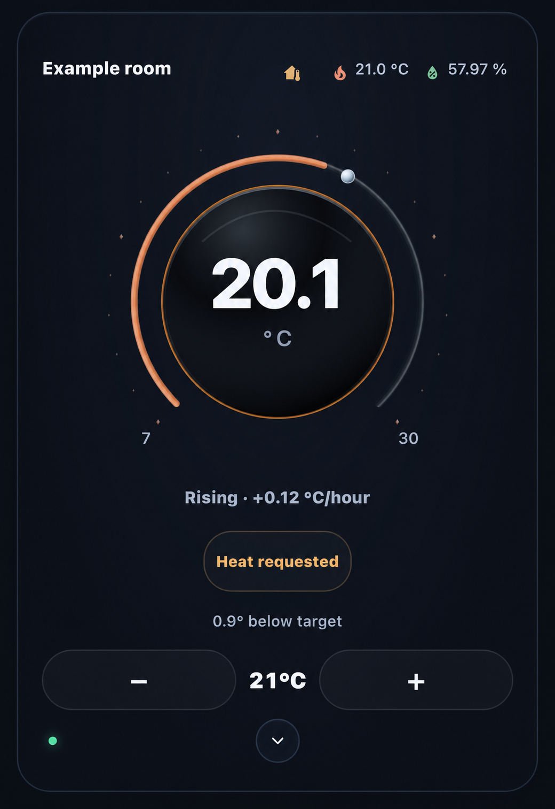
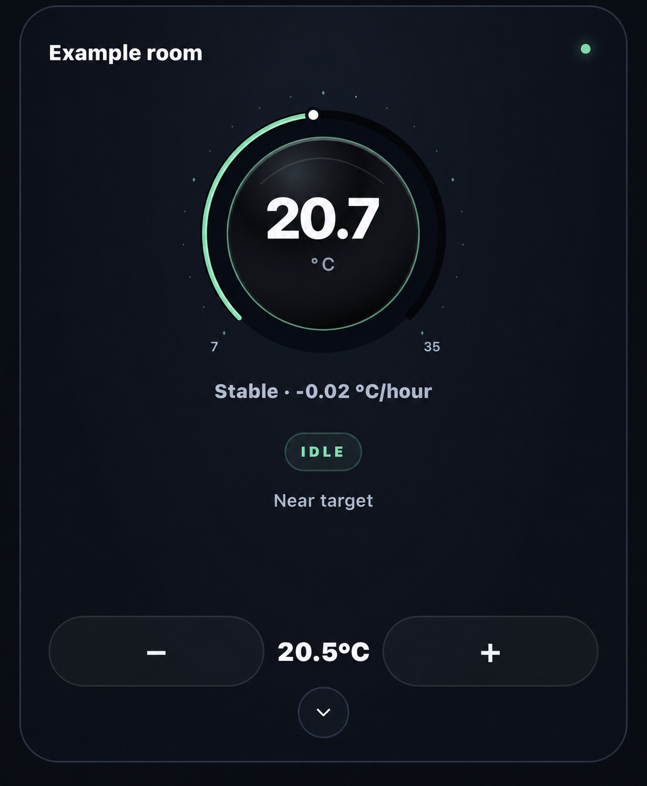
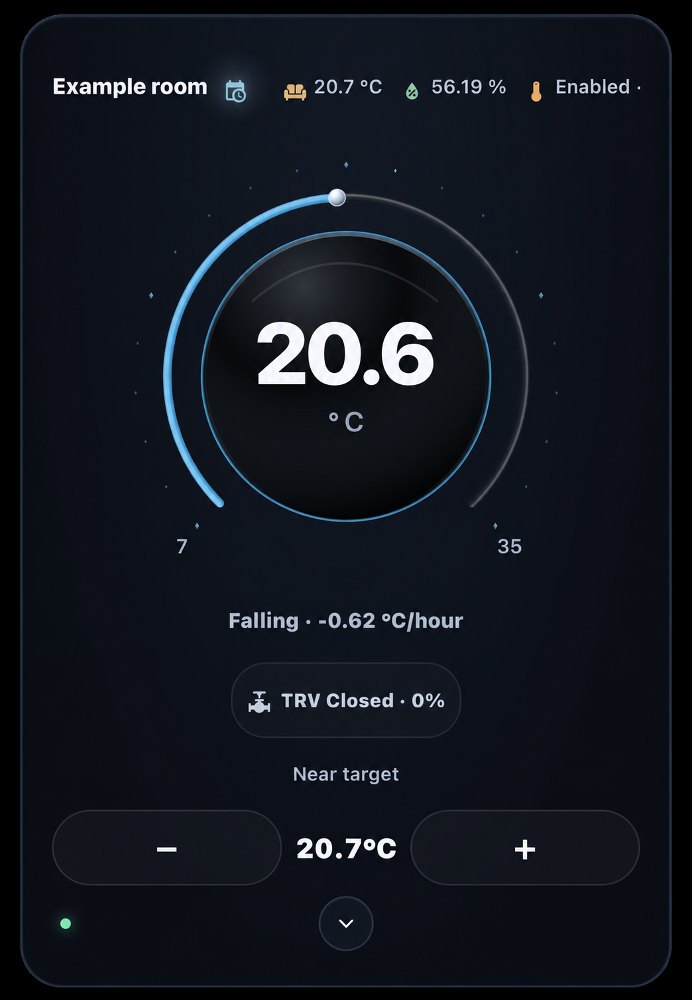
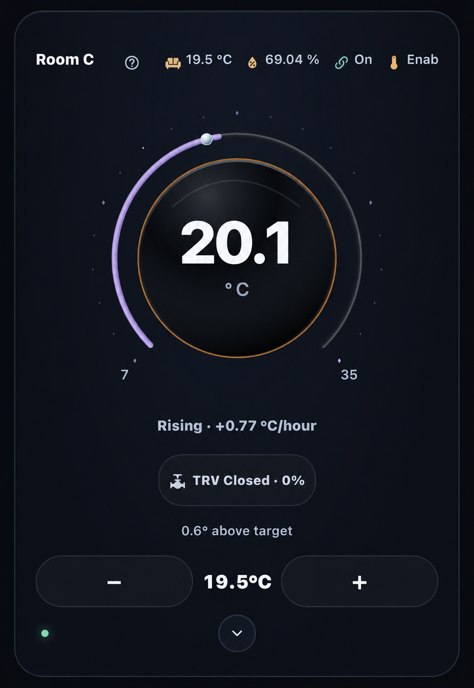
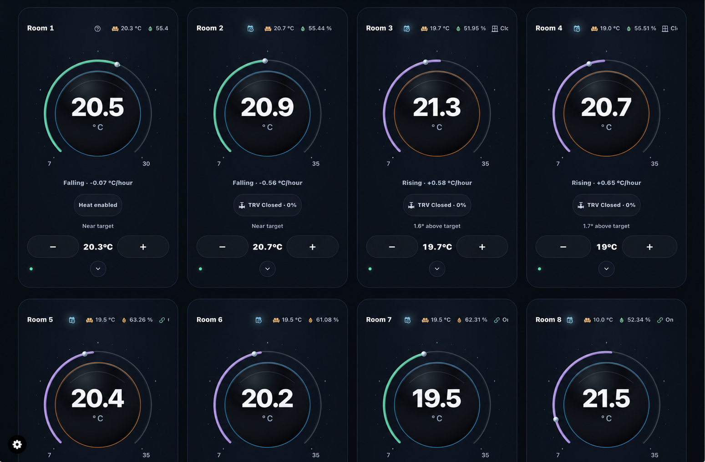
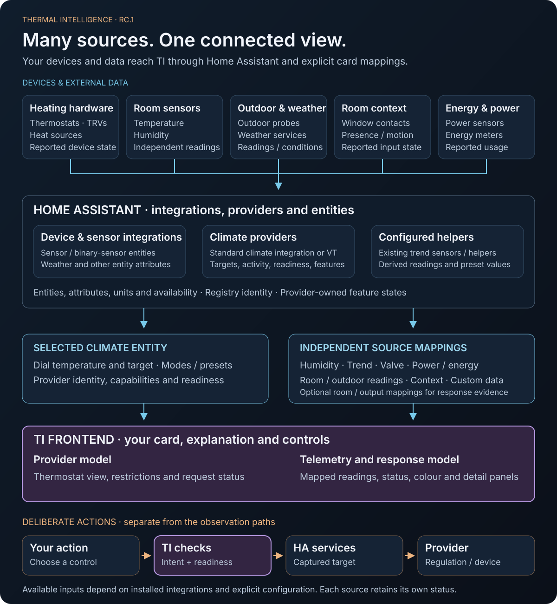

# Thermal Intelligence

**Temperature, control and context in one Home Assistant card.**

[Website](https://senyo888.github.io/thermal-intelligence/) · [Wiki](https://github.com/senyo888/thermal-intelligence/wiki) · [Install RC.1](docs/rc.md) · [Configuration](docs/card-configuration.md) · [Compatibility](docs/compatibility.md)

Thermal Intelligence brings current and target temperatures, supported thermostat controls and useful room observations into one considered interface. The glass dial, restrained lighting and focused detail panels keep everyday readings clear and further detail close at hand.

**RC.1** is the standalone thermostat release candidate. Start with a standard Home Assistant climate entity or Versatile Thermostat (VT), then choose the readings and controls that suit each room.

<table>
  <tr><th>Heat requested · rising</th><th>Idle · near target</th></tr>
  <tr>
    <td valign="top" align="center"></td>
    <td valign="top" align="center"></td>
  </tr>
  <tr><th>TRV closed · falling</th><th>Above target · rising</th></tr>
  <tr>
    <td valign="top" align="center"></td>
    <td valign="top" align="center"></td>
  </tr>
</table>

*Selected installation examples. Explore the [state gallery](docs/ui-examples.md) and [image context](docs/image-notes.md).*

## Every detail has a purpose

| At a glance | What you can read |
| --- | --- |
| **Glass dial and outer arc** | Current temperature, a target marker and colour that follows the room’s reported state and temperature response. Drag the marker or use minus/plus within the thermostat’s supported limits. |
| **Temperature-slope ring** | Rising, falling or steady temperature, with a readable rate and units alongside the colour. |
| **Status chip** | Reported Heating, Cooling or Idle; VT heat requests; or **TRV Open/Closed** with a mapped valve percentage. Tap for the source behind the status. |
| **Status LED** | Green for readiness, amber for restrictions or observations needing attention, and red for a disconnected or unavailable thermostat. Tap for provider details and request status. |

The arc, slope ring and status chip describe different parts of the room’s story. A valve can close while the room temperature continues to rise. The [reading guide](https://github.com/senyo888/thermal-intelligence/wiki/Reading-the-card) explains these combinations and the observations used for each colour.

## Your readings, arranged your way

Choose top-row readings, their order, labels and icons independently for each card. Humidity, trend, window, presence, motion and valve sources each add useful context. Configured icons open focused panels; missing or unknown readings remain clearly identified.

Set your own humidity display bands, select **Midnight Blue**, **Plum** or **Black**, and choose which details appear. The visual editor saves those preferences with the card.

The chevron opens **Controls & features**: supported modes, presets, fan or swing choices, and provider details. VT adds preset-temperature comparisons, feature observations and administrator [lock controls](docs/lock-control.md) where supported. When VT reports no optional Off or Mode reason, the overview shows **None reported**.

[Explore configuration](docs/card-configuration.md) · [See the detail panels](docs/ui-examples.md)

## Fits your thermostat

Use one card for a compact room view, or arrange several independently configured cards across a wider dashboard. The layout adapts to the available space, with touch-sized controls, keyboard access and reduced-motion support.

Start in **Add Card → Thermal Intelligence Thermostat · RC**. Select the climate entity, then map optional humidity, trend and valve sources. TI works directly with Home Assistant and your thermostat provider.

*An installation example showing independently configured rooms. [More layouts and states](docs/ui-examples.md).*

## Thermal Intelligence in your home

[Open the full-size diagram](assets/presentation/ti-ownership.svg).

| Responsibility | Owner |
| --- | --- |
| Device reports, room/outdoor measurements, context and energy | **Devices and data providers** |
| Card, mapped observations and validated user requests | **TI frontend** |
| States, registry and service access | **Home Assistant** |
| Regulation, schedules and device operation | **Thermostat provider** |

**TI brings together the observations you select.** Thermostats, TRVs, independent room sensors, outdoor readings, window/presence sensors and energy sources reach the card through Home Assistant. The climate entity and optional sensor mappings follow separate paths, so each reading keeps its source and status.

TI sends the actions you choose through Home Assistant’s services. Your thermostat provider retains regulation, schedules and device behaviour. [Architecture and ownership](ARCHITECTURE.md).

## Try RC.1

The [manual installation guide](docs/rc.md) provides the exact RC.1 module, SHA-256, setup and rollback steps. Keep existing TI resources in place and load one trial module at a time. Saved trial cards retain their configuration and `custom:thermal-intelligence-beta-card` type.

**HACS custom-repository distribution is the next step.** Its Dashboard metadata is prepared on `develop`; an installable release and isolated installation checks are pending. Follow [HACS preparation](docs/hacs.md) for the intended route. Marketplace remains part of the [distribution roadmap](docs/distribution.md).

[Compatibility and validation](docs/compatibility.md) records the tested versions, RC checks and remaining device coverage. RC.1 is a release candidate, with stable release acceptance tracked separately.

## Project direction

The standalone thermostat is the first component. Planned work includes House Climate, Effective Mode, Heating Control Centre, a portable backend and broader mobile/tablet dashboards. These will build on explicit ownership and explainable provider observations.

## Contributions

Useful reports include your TI, Home Assistant and provider versions, reproduction steps and a redacted configuration. Use the [issue forms](https://github.com/senyo888/thermal-intelligence/issues/new/choose), or read [Contributing](CONTRIBUTING.md) for code and documentation changes. [Changelog](CHANGELOG.md).

## Security

Report vulnerabilities through [private vulnerability reporting](https://github.com/senyo888/thermal-intelligence/security/advisories/new). [Security](SECURITY.md) explains what to include and how to keep sensitive details private.

## Support the project

Star the repository, share useful feedback, or [sponsor development](https://github.com/sponsors/senyo888).

Software is licensed under [GPL-3.0-only](LICENSE). Documentation and artwork have separate [reuse terms](docs/licensing-options.md).

---

   
  Explore our other projects 
  <a href="https://senyo888.github.io/humidity-intelligence/"><strong>Humidity Intelligence →</strong></a>

