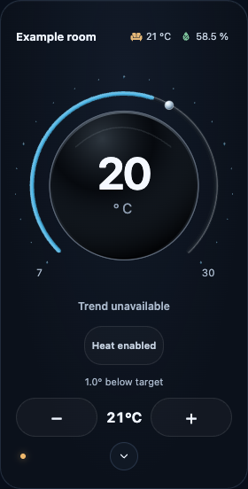
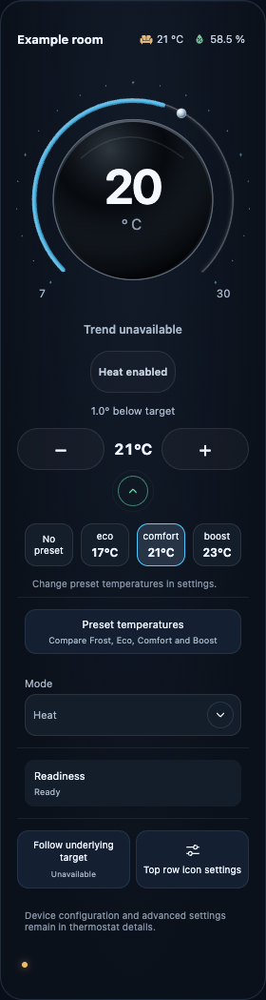
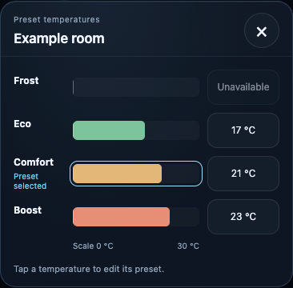
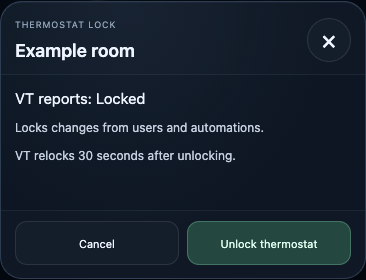
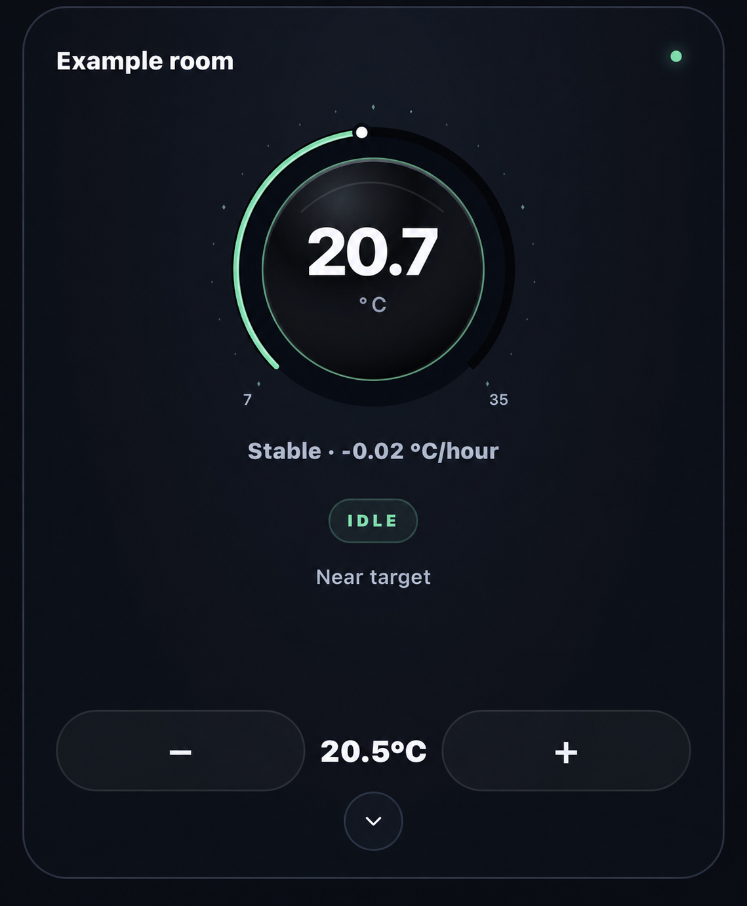
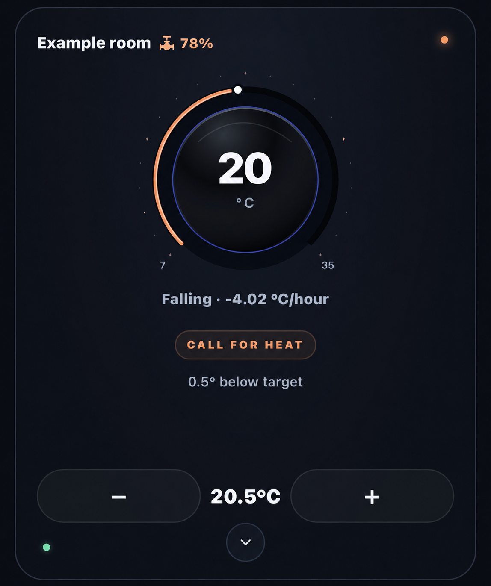
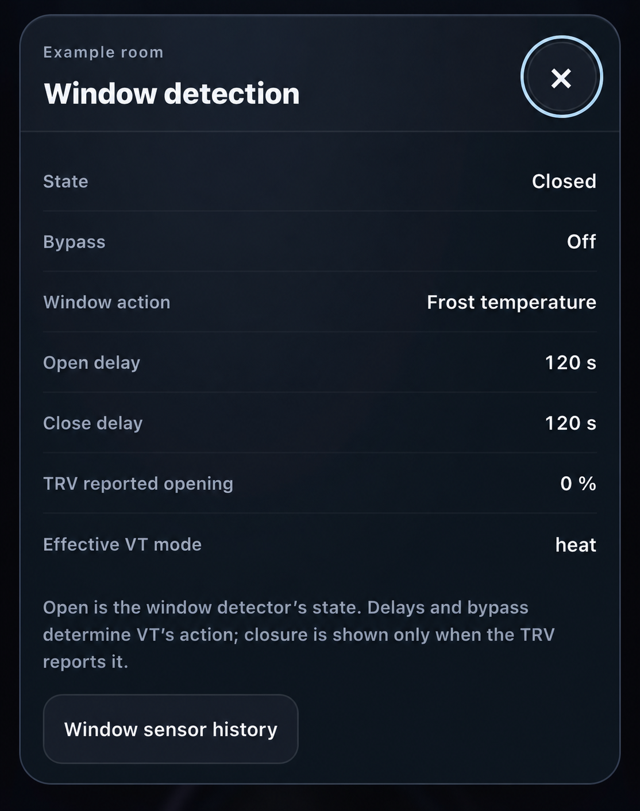
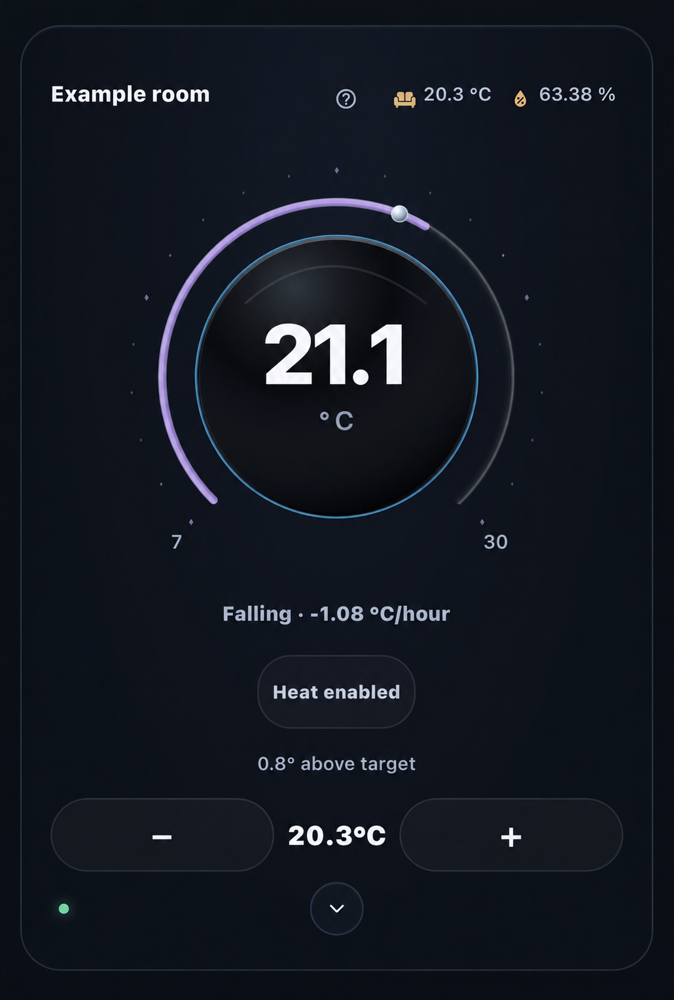

# Thermal Intelligence

**A clear view of temperature, control and what your thermostat is actually reporting.**

Created and maintained by **[Senyo · senyo888](https://github.com/senyo888)**.

**Beta 0.1.0-beta.3** · Home Assistant dashboard card · GPL-3.0-only software

[Beta installation](docs/beta.md) · [Configuration](https://github.com/senyo888/thermal-intelligence/blob/senyo888-patch-1/docs/card-configuration.md) · [Compatibility](https://github.com/senyo888/thermal-intelligence/blob/senyo888-patch-1/docs/compatibility.md) · [Report an issue](https://github.com/senyo888/thermal-intelligence/issues/new/choose)

Thermal Intelligence brings current and target temperatures, supported thermostat controls and device observations into one considered interface. The glass dial, restrained lighting, responsive controls and focused detail panels are the actual customer component.

<table>
  <tr>
    <td valign="top" align="center"></td>
    <td valign="top" align="center"></td>
  </tr>
</table>

*Actual beta.2 UI, rendered with synthetic data. The beta.3 response correction is described below. These images contain no private home configuration.*

## More information, without a crowded card

The everyday view stays simple: the room temperature, your target, a clear status and controls within reach. Behind that simplicity, the dial, colour, icons and small indicators each have a purpose. Tap for context, expand for controls, then return to the quiet overview.

### Read the room at a glance

| Detail | What it tells you |
| --- | --- |
| **Glass dial and outer arc** | The large reading is the current temperature; the pearl marker locates your target on the scale. The arc changes with the room's reported state and temperature response: orange for corroborated warming below target, cyan for reported cooling, green in the target band and lavender above it. Blue below target means warming is not yet established; Off and unavailable states are muted. Drag the marker or use minus/plus within the thermostat's reported limits. |
| **Temperature-slope ring** | The fine ring around the sphere shows the direction of temperature change from your configured trend source. Warm orange/red tones indicate rising readings, blues indicate falling readings, and green or pale tones indicate a near-flat trend. The accompanying Rising, Falling or Stable label gives the rate and units, so the colour has an explanation. Missing trend data is shown as unavailable. |
| **Dynamic status chip** | The chip adapts to the available evidence: reported Heating, Cooling or Idle; **Heat requested** for VT; or **TRV Open/Closed** with a reported valve percentage when mapped. **Heat enabled** means the mode is selected when activity is not reported. Tap the chip for the overview and the source behind the status. |
| **Status LED** | The small LED summarises connection and readiness: green for the card's ready state, amber when controls or observations need attention, and red when disconnected or unavailable. Tap it to open temperatures, modes, provider details and request status. A press-and-hold opens the registered device's Home Assistant settings, with thermostat details as the fallback. |

The outer arc, slope ring and activity chip are deliberately independent: the arc combines the room's state with corroborated temperature response, the fine ring shows measured temperature slope, and the chip reports activity. Idle is a reported activity, not a universal arc colour. A rising temperature slope can continue after the valve closes; the closed TRV does not establish an orange response arc.

**Orange has a specific meaning.** With the optional VT response sources configured, the room must be below its effective target, the current heat request must be accepted, and fresh room and trend readings must agree that it is warming. An open valve or a heating request alone is insufficient. When those observations expire, the arc returns to blue and the LED overview explains why. Standard thermostats and cards without response mappings retain the temperature comparison and reported cooling colours; they do not invent accepted-output evidence. [Response setup and colour meanings](https://github.com/senyo888/thermal-intelligence/blob/senyo888-patch-1/docs/card-configuration.md#temperature-response-arc).

The staggered glint of the small lights around the dial and the slope ring's gentle breathing preserve the original glass-and-light character. They add depth without replacing readable values or status text, and respect reduced-motion preferences.

### A top row that earns its space

Each configured icon combines a compact reading with colour that follows its meaning. Humidity follows your display bands; window, presence and motion distinguish **Open/Closed**, **Home/Away** and **Detected/Clear**; supported presets retain their own Frost, Eco, Comfort and Boost colours. Active, inactive and unknown observations receive distinct treatments, with missing information muted.

Choose which readings appear, their order, labels and icons for each card. Humidity, temperature, valve position and provider features can sit beside the room name without filling the main dial with detail. Tap a reading for its focused panel or Home Assistant source details. The compact VT lock indicates its reported state and opens [Lock/Unlock controls](docs/lock-control.md) for verified administrators when supported.

**Humidity presentation is customisable.** Set four boundaries for too dry, the start and end of your good range, and too wet. The display uses blue, amber, green, amber and red bands, with a reading and explanation in the humidity panel. These are visual preferences for this card; they do not change heating or humidity control. Save them through Home Assistant's visual card editor; the in-card adjustment panel provides a draft to copy.

### Open only the controls you need

The chevron reveals **Controls & features**: the thermostat's supported HVAC modes and presets, fan or swing choices where advertised, and relevant provider and telemetry details. VT can also expose its preset-temperature comparison, Follow setting information and configured feature observations. Top-row icon settings are available here too. Tap the centre temperature to open the thermostat's native Home Assistant details.

This keeps occasional settings close without putting every control on the everyday face of the card. Home Assistant and the selected thermostat remain in charge.

## One card, different setups

Start with a standard climate entity or configure **Versatile Thermostat (VT)**. Add an explicit **thermostatic radiator valve (TRV)** opening source when available, or use the thermostat's reported activity. Optional humidity, trend and other sensors build up the view independently; the card does not require a TI backend. Test-environment coverage includes Generic Thermostat and VT switch, climate, valve and combined climate/valve configurations. [Compatibility and its limits](https://github.com/senyo888/thermal-intelligence/blob/senyo888-patch-1/docs/compatibility.md) remain explicit.

For a phone, keep a compact room view with the most useful readings. For a tablet or wider dashboard, place several independently configured cards together and expand the room you are working with. The layout adapts to the space available, the top row scrolls when needed, and controls retain touch-sized targets and keyboard access. Choose **Midnight Blue**, **Plum** or **Black**, and set activity and detail visibility per card. Responsive browser checks cover phone, tablet and desktop widths; physical-device validation is still pending.

Ordinary setup is visual: **Add Card → Thermal Intelligence Thermostat · Beta**, choose your thermostat, then select the readings and presentation that suit that card. [Configuration guide](https://github.com/senyo888/thermal-intelligence/blob/senyo888-patch-1/docs/card-configuration.md).

See the preset detail panel

See administrator lock controls

*The code field appears only when VT reports a configured code. [Lock behavior and code-handling limits](docs/lock-control.md).*

See Idle and Call for heat examples

<table>
  <tr>
    <th>Idle</th>
    <th>Call for heat</th>
  </tr>
  <tr>
    <td valign="top" align="center"></td>
    <td valign="top" align="center"></td>
  </tr>
</table>

*Privacy-edited examples supplied by Senyo, with anonymised room names. Their source version was not recorded; the beta.2 captures above retain their recorded version.*

See window detection and Heat enabled examples

<table>
  <tr>
    <th>Window detection</th>
    <th>Heat enabled</th>
  </tr>
  <tr>
    <td valign="top" align="center"></td>
    <td valign="top" align="center"></td>
  </tr>
</table>

Window detection separates the detector state, configured response and reported valve opening. **Heat enabled** identifies the selected HVAC mode; it does not prove active heating.

*Privacy-edited examples supplied by Senyo, with anonymised names. Their source version was not recorded; the beta.2 captures above retain their recorded version.*

## Try the beta

The installable beta and its source are on **[senyo888-patch-1](https://github.com/senyo888/thermal-intelligence/tree/senyo888-patch-1)**. Start with the [verified package and installation guide](docs/beta.md).

The beta has separate card and editor names so it can coexist with an existing Thermal Intelligence installation. Keep existing cards and resources in place, and add **Thermal Intelligence Thermostat · Beta** for testing.

Testing covers HA **2026.10.0**, VT **10.5.1**, inert controller fixtures, installation, removal/reinstallation, update/rollback and deliberate no-code lock commands with automatic relocking. Code/error paths have synthetic coverage only. Physical thermostats, production deployment, a minimum supported version range and HACS installation remain unverified. This is a beta for controlled testing; there is no stable release yet.

## Project direction

The standalone thermostat is the first component. House Climate, Effective Mode, Heating Control Centre, a portable backend and broader mobile/tablet dashboards are planned. They are not included in this beta.

| Branch | Purpose |
| --- | --- |
| `main` | Public project presentation; future stable releases |
| `develop` | Integration branch; currently retains the foundation |
| `senyo888-patch-1` | Working source and initial installable beta |

## Support and contribution

Use the [issue forms](https://github.com/senyo888/thermal-intelligence/issues/new/choose) with your TI, HA and provider versions, reproduction steps and a redacted configuration. Report vulnerabilities through the [private security route](https://github.com/senyo888/thermal-intelligence/security/advisories/new).

Read [Contributing](CONTRIBUTING.md), [Security](SECURITY.md) and the [changelog](CHANGELOG.md). Software is licensed under [GPL-3.0-only](LICENSE); artwork and documentation have separate [scope notes](docs/licensing-options.md).
