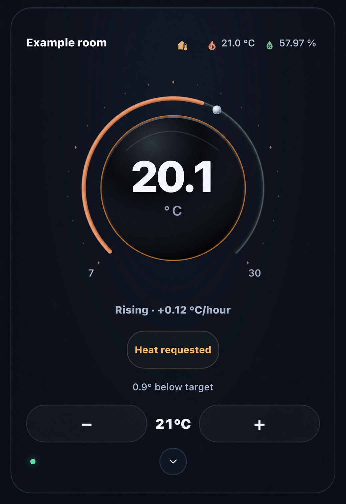
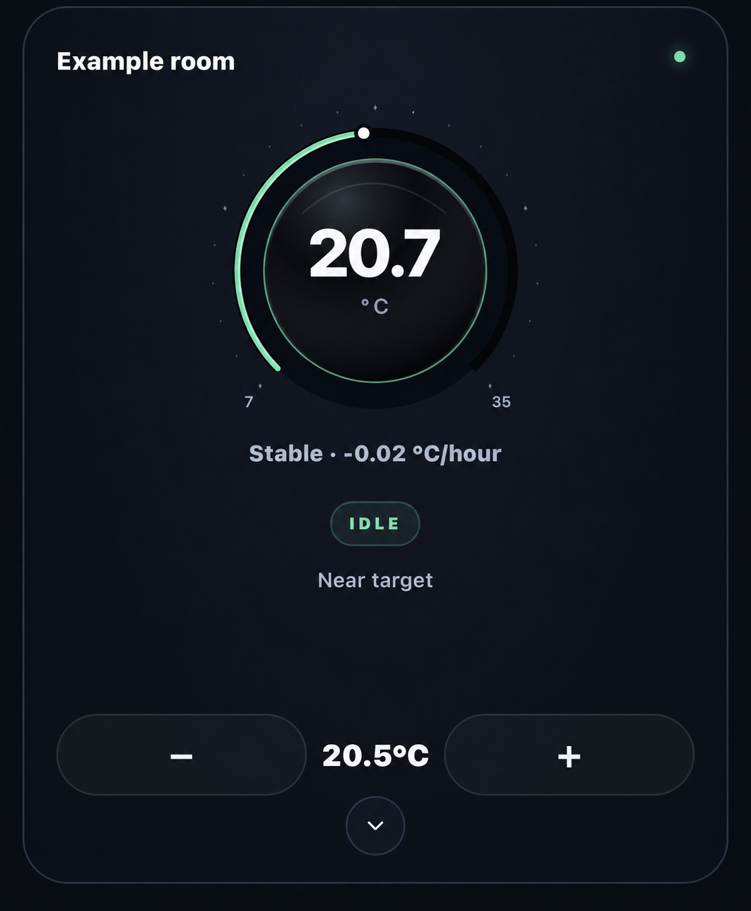
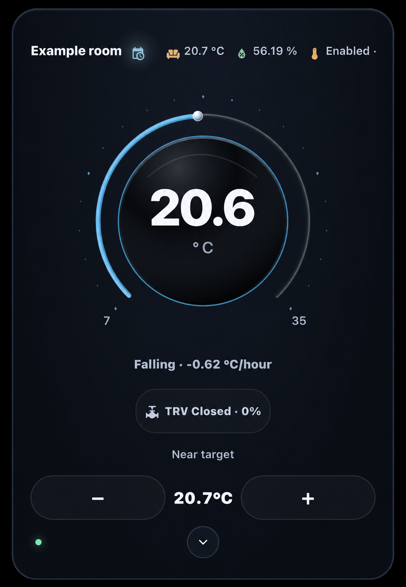
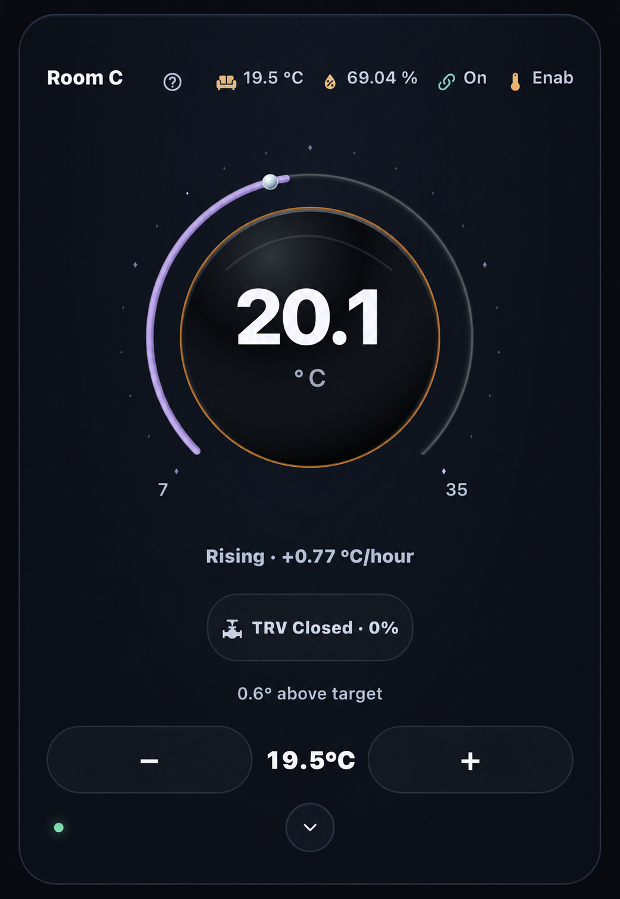
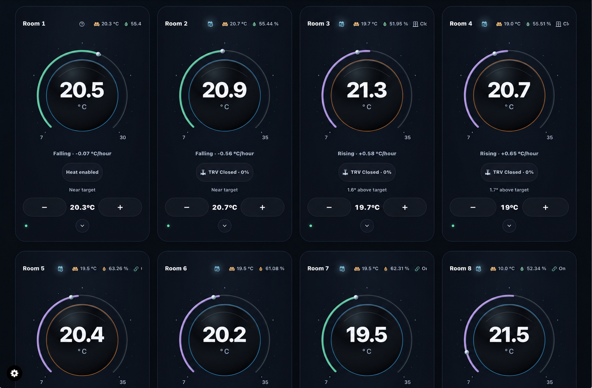
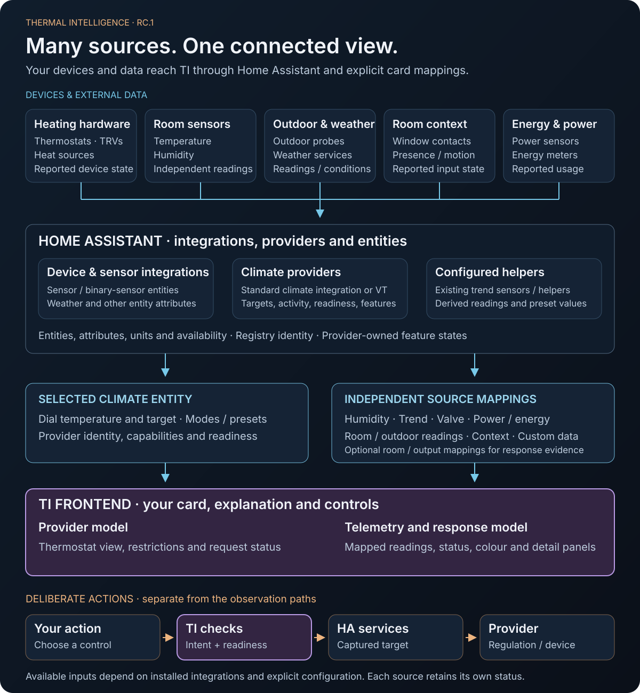

# Thermal Intelligence

**Temperature, control and context in one Home Assistant card.**

   

[v1.0.1 release notes](https://github.com/senyo888/thermal-intelligence/releases/tag/v1.0.1) · [Project site](https://senyo888.github.io/thermal-intelligence/) · [Wiki guides](https://github.com/senyo888/thermal-intelligence/wiki) · [Configuration and YAML](docs/card-configuration.md) · [Compatibility](docs/compatibility.md)

Thermal Intelligence puts your thermostat’s current temperature, target and reported activity on one Home Assistant card. Add the readings that help you understand a room. A closed radiator valve and a rising room temperature, for example, can both be true. Tap the status chip for the reported activity, or open a top-row icon to inspect its source.

**Start with your room’s thermostat.** Install [v1.0.1](https://github.com/senyo888/thermal-intelligence/releases/tag/v1.0.1) as a Dashboard card, then choose **Thermal Intelligence Thermostat** in Home Assistant. You can start with just your room’s thermostat.

## Set up your first room

1. With the card installed, open **Edit dashboard → Add card → Thermal Intelligence Thermostat**.
2. Choose your room’s **Thermostat entity** (`climate.*`) and leave **Provider** on **Automatic**. The dial gets the room temperature, target and supported controls from that entity and follows your Home Assistant temperature unit (°F or °C). Choose **Save**.
3. Edit the card again to add one useful reading. **With VT**, open **Readings and icons**, choose **Find VT sources** and inspect a suggestion before selecting **Use this source**. **With a standard thermostat**, choose a sensor yourself, such as a room humidity sensor reporting `%`. Both paths support independent sensors.
4. In **Readings and icons → Top row icon settings**, tick the reading, move it within its group, check the preview and **Save**. From the live card, **Controls & features → Top row icon settings** lets you try a layout. To keep that draft, copy its configuration into the same card’s code editor and save it there.

Want the room’s rate of change, the source behind a preset, or the orange response arc? [Walk through each setting](docs/wiki/Configuration.md) or [go straight to the YAML fields and units](docs/card-configuration.md).

<table>
  <tr><th>Heat requested · rising</th><th>Idle · near target</th></tr>
  <tr>
    <td valign="top" align="center"></td>
    <td valign="top" align="center"></td>
  </tr>
  <tr><th>TRV closed · falling</th><th>Above target · rising</th></tr>
  <tr>
    <td valign="top" align="center"></td>
    <td valign="top" align="center"></td>
  </tr>
</table>

*Selected installation examples. Explore the [state gallery](docs/ui-examples.md) and [image context](docs/image-notes.md).*

## Every detail has a purpose

| At a glance | What you can read |
| --- | --- |
| **Glass dial and outer arc** | Current temperature, a target marker and colour that follows the room’s reported state and temperature response. Drag the marker or use minus/plus within the thermostat’s supported limits. |
| **Temperature-slope ring** | Rising, falling or steady temperature, with a readable rate and units alongside the colour. |
| **Status chip** | Reported Heating, Cooling or Idle; VT heat requests; or **TRV Open/Closed** with a mapped valve percentage. Tap for the source behind the status. |
| **Status LED** | Green for readiness, amber for restrictions or observations needing attention, and red for a disconnected or unavailable thermostat. Tap for provider details and request status. |

The arc, slope ring and status chip describe different parts of the room’s story. A valve can close while the room temperature continues to rise. The [reading guide](docs/wiki/Reading-the-card.md) explains these combinations and the observations used for each colour.

## Your readings, arranged your way

Set up each room independently. Show humidity in one room and valve position in another. Tap a reading for its value, source and status. Presets and control source come first, followed by primary icons and then VT readings. In **Humidity display**, drag the four markers along the colour bar or enter exact percentages.

The calendar glows when Schedule has confirmed control. A green leaf appears in front of it when the thermostat is connected, available, ready and in **Heat** mode, and the displayed **Last confirmed schedule mode** is Eco. Without a schedule-mode mapping, the leaf follows the thermostat’s selected Eco preset under the same conditions. In forced-colours mode, the icon identifies the source without a glow. Tap the indicator to see each report. An unknown source and the hand marking a previous adjustment stay unlit.

**Controls & features** opens the thermostat’s advertised modes and presets, preset temperatures and card settings. VT can also expose accepted window, presence and motion states, estimated energy and provider settings. A compatible standard thermostat can use an explicitly enrolled [optional switch](docs/optional-switch-control.md). The card asks for confirmation before operating it.

[Explore configuration](docs/card-configuration.md) · [See the detail panels](docs/ui-examples.md)

## Fits your thermostat

Use one card for a compact room view, or arrange several independently configured cards across a wider dashboard. The layout adapts to the available space, with touch-sized controls, keyboard access and reduced-motion support.

For an extra temperature sensor, map a named or typed reading. The dial keeps the temperature reported by its own thermostat. A rate sensor drives the fine trend ring. The optional VT response arc also needs a matching room measurement and either confirmation of the underlying thermostat’s target or confirmed TRV output. Open the status chip to see which evidence the card has. [Set up temperature response](docs/card-configuration.md#temperature-response-arc).

*An installation example showing independently configured rooms. [More layouts and states](docs/ui-examples.md).*

## Thermal Intelligence in your home

[Open the full-size diagram](assets/presentation/ti-ownership.svg).

| Responsibility | Owner |
| --- | --- |
| Device reports, room/outdoor measurements, context and energy | **Devices and data providers** |
| Card, mapped observations and validated user requests | **TI frontend** |
| States, registry and service access | **Home Assistant** |
| Regulation, schedules and device operation | **Thermostat provider** |

**TI brings together the observations you select.** Thermostats, TRVs, independent room sensors, outdoor readings, window/presence sensors and energy sources reach the card through Home Assistant. The climate entity and optional sensor mappings follow separate paths, so each reading keeps its source and status.

TI sends the actions you choose through Home Assistant’s services. Your thermostat provider retains regulation, schedules and device behaviour. [Architecture and ownership](ARCHITECTURE.md).

## Installation

On Home Assistant 2026.11 or later, open **Settings → Marketplace** and search for **Thermal Intelligence**. On older systems, search for the same name in **HACS**. Open the Dashboard card by **senyo888** and select **v1.0.1**. [Marketplace steps](docs/marketplace.md) · [HACS steps](docs/hacs.md)

**Updating from v1.0.0?** Update the existing Marketplace or HACS entry to **v1.0.1**, then open a fresh dashboard tab. Your saved card carries over. Moving from a manual installation? Follow the [backup and ownership checks](docs/marketplace.md#before-installation) before installing, then verify the installer URL before reopening your dashboard. [Update and rollback](docs/migration.md)

## Acknowledgements

I built TI because I wanted to understand what each room was doing. A few projects made that possible, and I want to thank the people behind them.

- **The Home Assistant contributors** gave TI its home. The dashboard hosts the card, and the climate entity supplies the room temperature, target and supported controls. [Home Assistant climate integration](https://www.home-assistant.io/integrations/climate/)
- **jmcollin78 and the Versatile Thermostat contributors** make it possible to bring VT’s presets, outside temperature and room observations straight onto the card. If you use a standard thermostat, you can still build your card with your own sensors. [Versatile Thermostat](https://github.com/jmcollin78/versatile_thermostat)
- **The Home Assistant Marketplace and HACS contributors** give the community a way to install and update custom dashboard cards like TI. [Marketplace](https://www.home-assistant.io/integrations/marketplace/) · [HACS](https://www.hacs.xyz/)
- **Pictogrammers and the Material Design Icons contributors** created the icons TI uses through Home Assistant, from the humidity drop to the little sofa for Comfort. [Material Design Icons](https://pictogrammers.com/library/mdi/)

## Project direction

Thermostat is the first Thermal Intelligence card. Future plans include House Climate, Effective Mode and Climate Control Centre. This card works with the thermostat and schedules you already use.

## Contributions

Useful reports include your TI, Home Assistant and provider versions, reproduction steps and a redacted configuration. Use the [issue forms](https://github.com/senyo888/thermal-intelligence/issues/new/choose), or read [Contributing](CONTRIBUTING.md) for code and documentation changes. [Changelog](CHANGELOG.md).

## Security

Report vulnerabilities through [private vulnerability reporting](https://github.com/senyo888/thermal-intelligence/security/advisories/new). [Security](SECURITY.md) explains what to include and how to keep sensitive details private.

## Support the project

If TI has earned a spot on your dashboard, give it a star. A screenshot or a note about what worked in your room helps me make the next version better. You can also sponsor development.

  

Software is licensed under [GPL-3.0-only](LICENSE). Documentation and artwork have separate [reuse terms](docs/licensing-options.md).

---

   
  Explore our other projects 
  <a href="https://senyo888.github.io/humidity-intelligence/"><strong>Humidity Intelligence →</strong></a>

