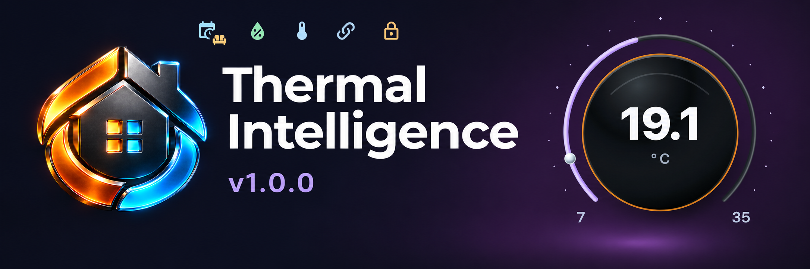
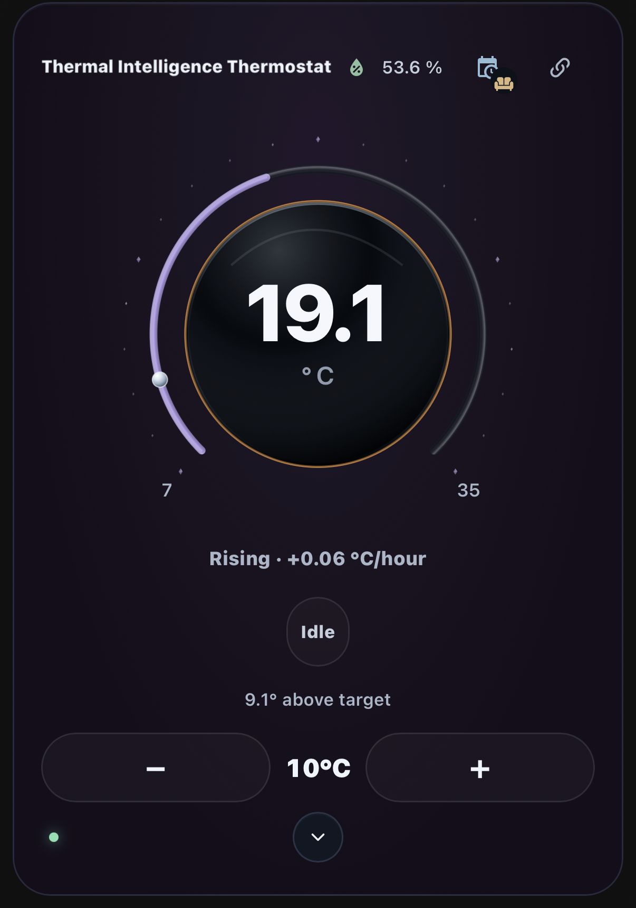
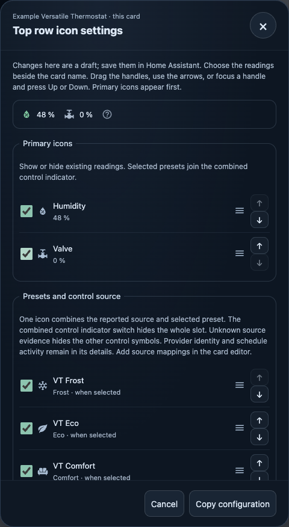
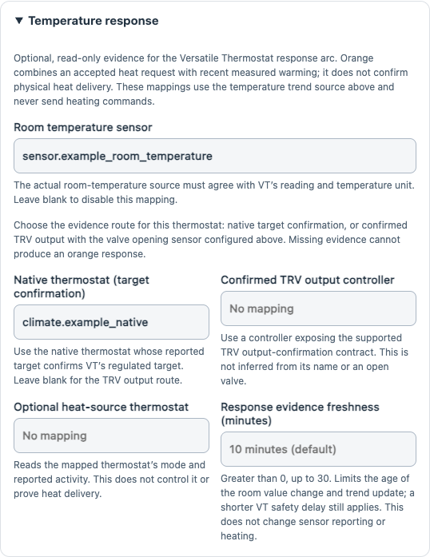

# Introducing Thermal Intelligence 1.0.0

  

Hi everyone,

I built Thermal Intelligence (TI) because I wanted more depth and insight from my thermostat card. Home Assistant gives us a wealth of information about our homes, from how far a radiator valve is open to how quickly a room is warming up. My aim with TI is to bring those readings together in a fresh design, so you can see how each room is responding and make better decisions about your home’s climate.

The Plum card below is a good example. The room is at **19.1°C**, the target is **10°C**, and the thermostat reports **Idle**. Look just below the dial and you can see the room is still warming slowly. That’s the bit I care about. I can see what I asked the thermostat to do and how the room is behaving, all in one glance.

You can adjust the target from the dial, choose a preset your thermostat supports, and decide what belongs across the top of each card. I like the temperature trend and valve position together. In another room, humidity or an open window might be the first thing you want to see. Tap a top-row reading to see where it came from.

**Start with one room.** Install **v1.0.0** as a Dashboard card through Marketplace, or use the [HACS guide](https://github.com/senyo888/thermal-intelligence/blob/6dd17cc1060bd218959ae0cb95d120e4a935a1e8/docs/hacs.md) if you’re on an older Home Assistant installation. Open **Edit dashboard → Add card → Thermal Intelligence Thermostat**, pick your room’s thermostat and save. Edit the card again and open **Readings and icons**.

- **Using Versatile Thermostat (VT)?** Choose **Find VT sources**, check the suggested reading and select **Use this source**. You can also tick readings VT already reports under **Top row icon settings → VT readings**.
- **Using your own sensors?** Pick a humidity sensor that reports a percentage, a temperature trend in degrees per hour, or a valve sensor that reports how far it’s open. You can use your own sensors with VT too.

Choose what you want to see, move it into place within its group and hit **Save**. Your thermostat and schedules carry on doing their jobs.

Here’s how I try a layout straight from the card. Open **Controls & features → Top row icon settings**. In this example I’ve put humidity first and valve position second within my primary readings. To keep that layout, choose **Copy configuration**, paste it into the same card’s dashboard code editor and save.

If you use VT and want to know why the outer arc turns orange, open **Temperature response** in the dashboard editor. This example pairs the room sensor VT uses with the underlying thermostat that confirms its target. With a matching temperature trend, TI can show when an accepted heat request lines up with the room warming below target. You can leave this off and still use the dial and trend ring.

A special thanks to [@dthomas946](https://github.com/dthomas946) for asking if the emergency heat switch on their heat pump could sit alongside Mode and Fan. That request helped shape the optional switch in **Controls & features**. [Issue #8](https://github.com/senyo888/thermal-intelligence/issues/8)

I built TI for my own home, and I’m proud to share this first release with you. Some days, all I want to know is whether to turn the heating up or give the room another ten minutes. I hope TI makes that call a little easier in your home too.

Thanks for giving it a try,\
Senyo

## Support the project

If TI has earned a spot on your dashboard, give it a star. You can [share your setup in the gallery](https://github.com/senyo888/thermal-intelligence/issues/new?template=ui_gallery_submission.yml), send feedback, or sponsor development.

  
