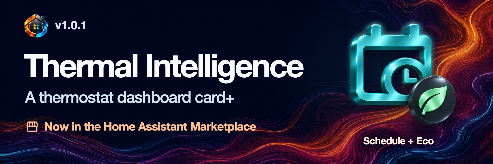

# Thermal Intelligence v1.0.1

## A thermostat dashboard card+

 

When a schedule runs a room in Eco, the calendar now glows softly behind the green leaf. You can read both at a glance. The calendar tells you who’s in control, and the leaf shows Eco. If you’ve mapped a Schedule preset, the leaf shows the last one your schedule confirmed.

You’ll see the same glow when House, Manual, Versatile Thermostat (VT) or another configured source has confirmed control. The hand with a history marker stays unlit because it shows a past adjustment. The glow also stays off while the card is waiting for fresh information.

**Already using TI?** If Marketplace or HACS manages your card, update its existing entry. If you installed TI manually, follow the [resource transition steps](https://github.com/senyo888/thermal-intelligence/blob/e7282506caa725aaf27aaee8229545a44fbe28c5/docs/marketplace.md#before-installation) before choosing **Install**. Your saved cards carry over. [Update and rollback guide](https://github.com/senyo888/thermal-intelligence/blob/e7282506caa725aaf27aaee8229545a44fbe28c5/docs/migration.md)

**Thermal Intelligence is now in the Home Assistant Marketplace.** On Home Assistant 2026.11 or later, open **Settings → Marketplace**, search for **Thermal Intelligence**, and choose the **Dashboard** card by **senyo888**. On older installations with HACS, search for the same name in HACS.

Senyo
