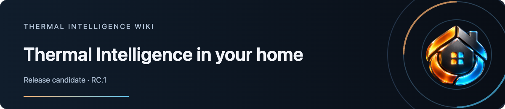
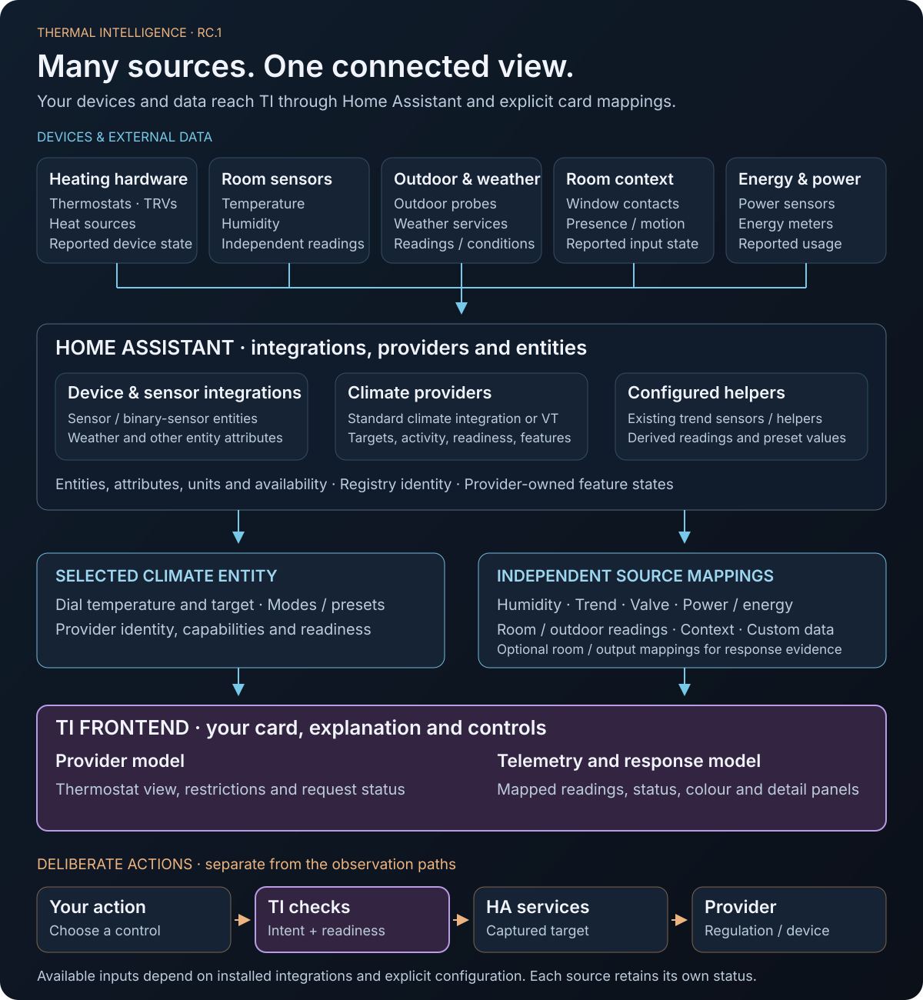

# Thermal Intelligence in your home

Thermal Intelligence brings together a selected thermostat and the additional observations you choose. Thermostats and TRVs sit alongside independent room sensors, outdoor data and other integrations in the wider system.

[Open the full-size graph](https://raw.githubusercontent.com/senyo888/thermal-intelligence/main/assets/presentation/ti-ownership.svg).

## Devices and external data

| Source | What reaches Home Assistant | How TI uses it |
| --- | --- | --- |
| Thermostats, TRVs and heating hardware | Climate state, target, activity and provider attributes | Selected thermostat view, supported controls and provider details |
| Independent room and TRV sensors | Temperature, humidity and reported valve position | Explicit named readings, humidity/valve mappings and optional response evidence |
| Outdoor probes and weather services | Outdoor temperature, other readings and reported conditions | Explicit feature/custom-telemetry readings from an entity or scalar attribute |
| Window, presence and motion sensors | Raw contact or occupancy observations | Configured context indicators, kept distinct from VT’s accepted feature states |
| Power and energy sources | Reported power and accumulated energy | Typed optional observations with their units and availability |
| Existing HA helpers and derived sensors | Temperature slope and other configured derived values | Explicit trend or named source mappings |

Availability depends on your installed integrations. Map only the sources relevant to each card.

## Home Assistant brings the sources together

Integrations expose the entities and attributes. Climate providers such as VT manage their own configured inputs, regulation and feature decisions. Helpers can supply derived values such as temperature trend. TI reads those outputs through Home Assistant’s state and registry information.

Two paths then enter TI: the **selected climate entity**, and **independently configured sensor/telemetry sources**. An outdoor or room sensor can reach TI directly through its HA entity; it does not have to pass through the thermostat provider.

## Each reading keeps its meaning

The main dial uses the selected climate entity’s current temperature and target. A separately mapped room/TRV temperature supplies an additional reading or response evidence; it does not automatically replace the dial’s temperature source.

Outdoor/weather mappings present scalar readings or reported conditions. Forecast processing and weather-driven control belong to separate provider/backend contracts. TI reads an existing configured trend source rather than calculating a trend from room-temperature history.

Raw window, presence and motion inputs stay distinct from the states VT accepts after its configured rules and delays. Each mapped reading keeps its source, units, availability and applicable freshness information. [Configure the sources](Configuration).

## Acting on your choices

An explicit action captures its thermostat target. TI checks capability and readiness, then calls the supported Home Assistant service. The provider handles regulation and device operation; the card follows the resulting observations. Setup, rendering and reconnecting do not send commands or replay earlier requests.

## Looking ahead

House Climate, Effective Mode, Heating Control Centre and a portable TI backend are planned separately from the RC.1 frontend. Their future contracts will define control ownership and failure behaviour.

[Full architecture contract](https://github.com/senyo888/thermal-intelligence/blob/develop/ARCHITECTURE.md) · [Command contract](https://github.com/senyo888/thermal-intelligence/blob/main/docs/command-contract.md) · [Provider contracts](https://github.com/senyo888/thermal-intelligence/blob/main/docs/provider-contracts.md)
