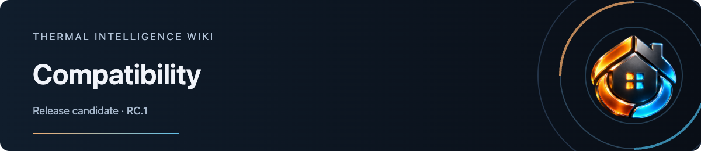

# Compatibility

Candidate: **0.1.0-rc.1** on `develop`. The [RC guide](https://github.com/senyo888/thermal-intelligence/blob/main/docs/rc.md) identifies the package and candidate checks. The table below records the beta.4 baseline; it is not an RC soak result. A minimum supported Home Assistant version and a broader support range have not yet been established.

| Environment or feature | Coverage |
| --- | --- |
| Home Assistant 2026.10.0 · VT 10.5.1 | Dedicated test environment with Generic Thermostat, VT switch, climate, valve and combined climate/valve configurations using inert outputs |
| Home Assistant 2026.10.4 · VT 10.5.1 | Passive frontend trial alongside existing TI cards; beta.4 readings, health LED and provider details checked |
| Installation and rollback | Manual resource installation, removal/reinstallation, update, rollback and reapplication exercised in the test environment |
| VT lock without a code | Deliberate native Lock/Unlock and provider automatic relocking checked on an inert fixture |
| VT lock code/error paths | Synthetic tests only; see [provider logging limitation](https://github.com/senyo888/thermal-intelligence/blob/main/docs/lock-control.md#code-handling-and-provider-limits) |
| VT response arc | Synthetic positive, restricted, mismatching, stale and expired evidence; real HA checks cover unmapped configurations |
| Phone, tablet and desktop widths | Responsive Chromium fixtures, keyboard and reduced-motion checks; physical devices and Companion apps remain unverified |
| HACS | Installation, updates and catalogue inclusion are unverified |
| Other climate integrations | Provisional; require integration-specific checks |
| Physical heating response | Unverified; activity and valve readings do not prove heat delivery |

Beta.4 passed **135 unit tests, 81 browser tests and 5 packaging tests**. Coverage includes configuration preservation, provider identity and readiness, command races, no replay after reconnect, escaped rendering and degraded observations. The built module's health checks retain amber for incomplete observations and red for disconnected or unavailable thermostats. A completed scoped security review reported no findings.

These results apply to the recorded versions and scenarios. They do not establish compatibility with every thermostat, browser or Home Assistant release.

RC.1 changes release identity and packaging; it does not change thermostat commands, provider interpretation, response-arc rules or the health LED.

## RC.1 observation and package checks

The 48-hour RC.1 controller observation completed on 2 November 2026 against module SHA-256 `763814e1e797c72a8960fec2b928d945dc6fc1056d7ced366d4241ae81304117`. All nine scheduled checkpoints passed Home Assistant Core, served-module identity, VT provider and reported-version checks on Home Assistant 2026.10.0 with VT 10.5.1. UI coverage was recorded at the first checkpoint; eight later UI observations, including the final retained-page and fresh-render checks, were unavailable. These are periodic observations, not proof of continuous uptime, browser execution or physical heating. The UI gaps remain part of this result.

The versioned RC.1 package at `9d9ed9744c29a494d45501a8bb1359edd465c5c4` passed 135 unit, 81 synthetic browser, 13 packaging and eight distribution tests on 2 November 2026. Repeated packages matched byte for byte. These offline checks do not establish HACS installation, migration, removal, recovery or update acceptance; a genuine update test needs two approved, installer-visible versions. Physical-device, Companion, code-protected lock and mapped response-arc acceptance remain separate.

## Report a compatibility issue

Include your TI, Home Assistant, provider and browser/Companion versions, installation method, a minimal redacted card configuration and reproduction steps. State whether the issue affects rendering, controls, provider observations or resource loading. Use the [issue forms](https://github.com/senyo888/thermal-intelligence/issues/new/choose).
