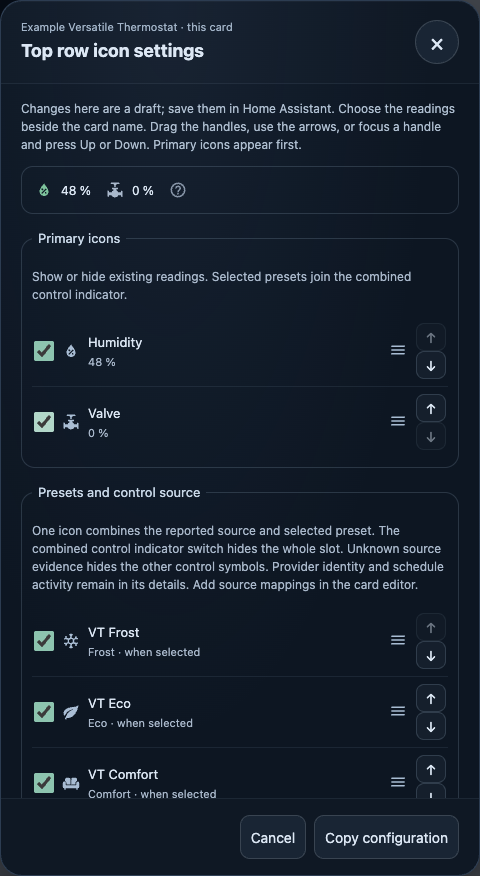
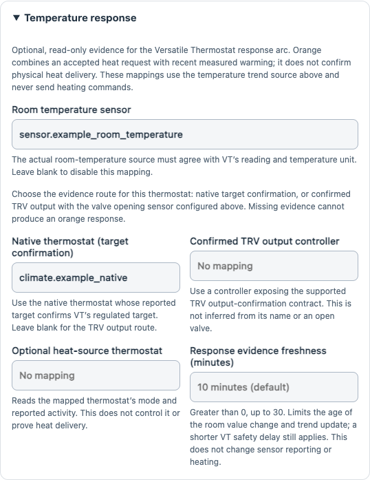

# Configure your first thermostat

Start with one room. Once its dial shows the temperature and target you recognise, add the readings you actually use. Each card has its own sources and layout.

This walkthrough covers **Thermal Intelligence Thermostat** in the prepared **1.0.0** package. The published RC.3 picker adds **· RC** and has an earlier editor. [Published RC.3 installation guide](https://github.com/senyo888/thermal-intelligence/blob/main/docs/rc-3.md)

## Get a working dial

1. Open a dashboard you can edit. Choose **Edit dashboard → Add card → Thermal Intelligence Thermostat**. To change an existing card, choose **Edit** on that card.
2. Under **Thermostat entity**, choose the room’s `climate.*` entity. If you use Versatile Thermostat (VT), choose the VT that regulates the room. A standalone temperature sensor can supply a reading, but the dial needs a climate entity.
3. Leave **Provider** on **Automatic** for a registered thermostat. Check that the preview shows the right room, current temperature and target or target range. The provider supplies the available modes, presets, limits and step.
4. Select **Save**. Reopen **Edit** whenever you want to add readings. You can check the finished card without moving a target.

**Prefer YAML?** Replace the example thermostat with yours and paste this in the card’s code editor. The picker and exports use the type below. Dashboards saved with `custom:thermal-intelligence-beta-card` can keep that type.

```yaml
type: custom:thermal-intelligence-thermostat
entity: climate.example_room
```

## Choose your sources

**With VT**, expand **Readings and icons → Top row icon settings → VT readings** and tick an observation such as room-temperature receipt age or outside temperature. TI reads the selected VT’s report directly. For reusable sensor mappings, open **Readings and icons**, choose **Find VT sources**, inspect the suggested value and select **Use this source**. For example, a matching VT slope sensor can supply the trend ring. If that sensor is disabled, enable it in Home Assistant or pick a suitable existing rate sensor. TI leaves features and existing mappings as you configured them.

**With a standard thermostat**, start with the same dial. In **Readings and icons**, choose a humidity sensor reporting **%**, a trend sensor reporting **°C/h** or **°F/h**, or a valve-position sensor reporting **%**. Add just one and inspect the preview. You can also map independent sensors this way on a VT card. **Provider → Standard climate** or **Versatile Thermostat** explicitly identifies a provider when appropriate. A verified VT still needs to report ready before its controls work. Mapping sources manually is separate from a controller reporting **Manual** as the room’s control source.

| Reading or icon | What to select and what you’ll see |
| --- | --- |
| Humidity | Choose the room’s relative humidity sensor. Tap the reading for its current band and available history. In **Humidity display**, drag four markers on one colour bar or enter exact percentages below it. Defaults are 30, 40, 60 and 70%. These boundaries colour this card. |
| Temperature and trend | The dial uses the climate entity’s current temperature. Add another temperature as typed telemetry for comparison. A signed rate sensor drives the fine ring and Rising, Stable or Falling text. |
| Outside | In **Outside temperature**, choose a temperature sensor or a weather entity and select **Add outside reading**. With weather, TI reads its temperature and unit attributes. The optional VT outside reading shows the value VT last received. |
| Valve and activity | Map a valve opening from 0–100% to see **TRV Open/Closed** and its position. Without a valve mapping the card uses reported thermostat activity. **Heat requested** describes a VT request. |
| Window, presence and motion | Choose a contact or occupancy source as typed telemetry, or select VT’s accepted state. Open/Closed, Home/Away and Detected/Clear answer different questions. A VT delay can leave a raw motion sensor and VT’s accepted motion state temporarily different. |
| Power, energy and other VT readings | Use explicit telemetry for a meter. VT also offers estimated energy, estimated mean power, configured device power, power limiting, Follow, automatic window detection and auto start/stop when reported. Tap the icon to inspect its source. |
| Control source and preset | The combined indicator can show House, Schedule, Manual or another reported source with its applicable preset or mode. Tap it for the separate reports. An unmapped owner can be Unknown. A hand with a history marker identifies the last confirmed adjustment made on this card. |

The in-card humidity panel also has a shared colour track under **Advanced draft and export**. To save thresholds directly, use the same colour bar or the percentage fields in the dashboard editor.

## Arrange the top row

**Save a change to the dashboard.** Open **Edit dashboard → Edit** on the card, then **Readings and icons → Top row icon settings**. Tick the readings you want. Drag the handle within its group, use the arrow buttons, or focus the handle and press Up or Down. For example, move humidity above a second room reading. Compare the draft preview, choose Home Assistant’s **Save**, then reopen the card to check the result.

**Try an arrangement from the card.** Expand **Controls & features → Top row icon settings**. Preview, reorder or use **Add reading**. To keep the result, choose **Copy configuration**, edit this same dashboard card, open its code editor, paste the complete configuration and choose **Save**. Closing the runtime dialog discards its draft. The **Card settings** utility also opens **Readings and display**, which offers **Advanced draft and export**.

<details><summary>See the top-row draft and its copy button</summary>



Synthetic room in the 1.0.0 card. The footer stays visible as you scroll through the groups.

</details>

In 1.0.0 the settings groups run **Presets and control source → Primary icons → VT readings**. Hiding a primary icon keeps its source available in expanded readings. VT checkboxes opt into provider observations. The combined indicator has its own visibility setting, and individual preset choices determine which badge can join it. The lock and status LED keep their own positions.

## Set up temperature response

Start with the fine ring. Select the room’s measured slope under **Readings and icons**. An ordinary temperature sensor reports degrees. The ring needs a signed change in degrees **per hour or minute**. If your standard thermostat lacks a rate sensor, you can create one in Home Assistant under **Settings → Devices & services → Helpers → Create helper → Derivative**. Select your numeric room temperature sensor, use hours, leave the metric prefix empty and check the resulting unit and value before mapping it. [Home Assistant Derivative helper](https://www.home-assistant.io/integrations/derivative/)

**For the optional orange VT arc**, open **Temperature response** and select the actual **Room temperature sensor** VT uses. Map the trend that agrees with VT’s own slope. Then choose the route your hardware supports.

| VT controls | What to configure |
| --- | --- |
| A native thermostat | Pick **Native thermostat (target confirmation)**. Use the underlying climate entity reporting the regulated target. Leave valve-position and confirmed-output mappings unset for this route. |
| A thermostatic radiator valve (TRV) through a confirming controller | Map **Optional TRV opening sensor (%)** under **Readings and icons**, then select **Confirmed TRV output controller** under **Temperature response**. Its output confirmation must meet the documented contract. An ordinary valve percentage supplies the position display on its own. |

If your system has a separate thermostat for the heat source, **Optional heat-source thermostat** also checks its reported mode. Leave that field empty otherwise. Start with the default 10-minute **Response evidence freshness** window. A shorter VT safety delay takes precedence. The room reading, VT and card must agree on temperature units. Below target, orange requires a current accepted heat request and fresh, matching evidence of ordinary warming. If the arc stays blue, open the status chip or LED and read **Temperature response** for the missing or expired evidence. You can use the ordinary target comparison and the slope ring without setting up this optional VT feature. [Response fields, example and colour key](https://github.com/senyo888/thermal-intelligence/blob/fe8414957fd490fa412eaa80920ecfe84f5e9561/docs/card-configuration.md#temperature-response-arc) · [Output confirmation requirements](https://github.com/senyo888/thermal-intelligence/blob/fe8414957fd490fa412eaa80920ecfe84f5e9561/docs/provider-contracts.md#temperature-response-evidence)

<details><summary>See a native thermostat response mapping</summary>



Example entities in the 1.0.0 editor. Use the entities that report these values in your room.

</details>

## Tune the remaining settings

| Setting | Use it when… |
| --- | --- |
| **Card name**, **Background**, **Show activity**, **Show details** | Give this room a short name, choose Midnight Blue, Plum or Black, show the activity summary, or show the compact **Readings** button under expanded controls. |
| **Custom telemetry & features** | Give an entity or attribute its own label and named icon. A numeric temperature feature can be associated with an exact advertised preset for comparison. |
| **Optional telemetry** | Select the reading’s kind, entity and optional attribute path. For numeric attributes, specify the actual unit or its unit attribute. Set a maximum age only when you know how often the source should report. |
| **Control source, House policy and schedule** | Map a controller’s confirmed owner, effective House preset, last confirmed Schedule mode or separate schedule activity. Use the controller’s thermostat binding and readiness attributes where available. These fields display reports. Schedule creation and owner selection belong to the controller. |
| **Preset display labels** | Rename an advertised preset on this card. The provider keeps its original preset and target. Open **Preset temperatures** to compare any available values. |
| **Optional switch control** | For an eligible registered standard thermostat, search for one supported switch, select it and explicitly enable it. Both On and Off require confirmation on the card. VT settings and lock controls have separate provider routes. |
| **Advanced display settings** | Set a fallback temperature step when the thermostat omits its own. Home Assistant’s display unit and the thermostat’s valid range still apply. |

See the [complete YAML and editor reference](https://github.com/senyo888/thermal-intelligence/blob/fe8414957fd490fa412eaa80920ecfe84f5e9561/docs/card-configuration.md), [optional switch requirements](https://github.com/senyo888/thermal-intelligence/blob/fe8414957fd490fa412eaa80920ecfe84f5e9561/docs/optional-switch-control.md) and [lock controls](https://github.com/senyo888/thermal-intelligence/wiki/VT-lock-control).
