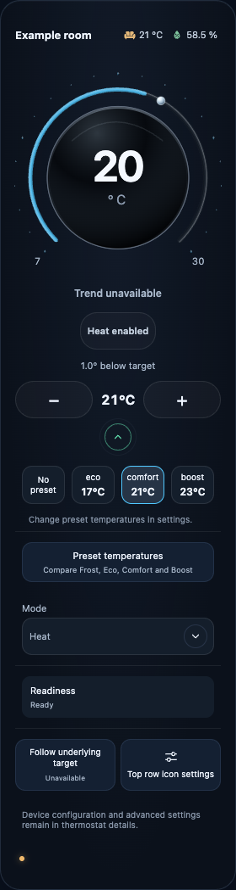
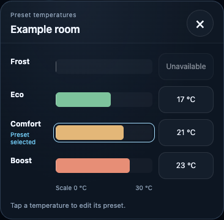

# Configure your card

Load the beta module, then choose **Add Card → Thermal Intelligence Thermostat · Beta**. Select your thermostat and use the visual editor for ordinary setup.

- **Provider:** use verified registry identity or choose the provider explicitly. VT readiness and restrictions remain visible.
- **Readings:** map humidity, trend and valve-position sources independently. Missing optional data affects only the relevant information.
- **Top row:** select readings, order, labels and icons per card. Window shows Open/Closed; presence shows Home/Away; motion shows Detected/Clear.
- **Presentation:** choose Midnight Blue, Plum or Black and set activity/detail visibility.
- **Humidity guides:** choose four boundaries for too dry, the good range and too wet. These change display colours only. Save through the visual card editor; the in-card adjustment panel provides a draft to copy.
- **Response arc:** optional read-only VT mappings support the corroborated warming indication. A valve percentage alone does not provide that evidence.

[Full configuration reference and examples](https://github.com/senyo888/thermal-intelligence/blob/senyo888-patch-1/docs/card-configuration.md) · [Response-source setup](https://github.com/senyo888/thermal-intelligence/blob/senyo888-patch-1/docs/card-configuration.md#temperature-response-arc)

VT Presence and Motion

Presence selects home/away preset temperatures. VT Motion selects motion/no-motion temperatures while its Activity preset is active, after the provider’s configured delays. A raw sensor and VT’s accepted feature state can differ during those delays. TI displays the configured source and does not change VT’s policy.

Expanded controls and preset details

 

Actual beta.2 captures with synthetic data, illustrating controls retained in beta.4. [Image notes](https://github.com/senyo888/thermal-intelligence/blob/main/docs/image-notes.md).

Saved schema-1 configurations remain valid in beta.7. Unknown fields survive editor round trips; preserving a field does not make an unsupported option operational. [Update and rollback](https://github.com/senyo888/thermal-intelligence/blob/senyo888-patch-1/docs/migration.md).

## Optional switch development candidate

Available from beta.6 and retained in beta.7, the card offers one explicitly enabled switch beside Mode/Fan for a registered standard thermostat. Its visual editor requires enrollment and runtime confirmation in both directions. It needs no TI controller. Released RC.1 and beta.5 do not include it. See the [optional-control guide](https://github.com/senyo888/thermal-intelligence/blob/senyo888-patch-1/docs/optional-switch-control.md) for the exact schema, Honeywell Off behavior, restrictions and configuration-plus-module rollback.
