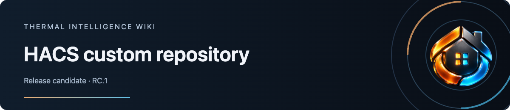

# HACS custom repository

HACS is the planned next installation route for the RC.1 frontend. Thermal Intelligence belongs in HACS’s **Dashboard** category. It installs a dashboard resource; it does not add a Home Assistant backend integration.

## Current route

Use [manual RC.1 installation](Installing-the-release-candidate) today. Dashboard metadata and repeatable package checks are present on `develop`. The public default branch contains documentation; the versioned release and isolated HACS installation checks are still being prepared.

## When the versioned release is available

These steps describe the intended route. Use them after the release guidance identifies a published, validated candidate and the supported HACS version.

1. Back up the test environment and save the current dashboard/resource configuration.
2. Check that `www/community/thermal-intelligence/` and its resource prefix are available for this package. If they contain existing TI or unrelated files, preserve them and review [resource ownership and migration](https://github.com/senyo888/thermal-intelligence/blob/develop/docs/distribution.md#existing-installations-and-migration) first.
3. In HACS, open the menu, choose **Custom repositories**, and enter `https://github.com/senyo888/thermal-intelligence` with category **Dashboard**.
4. Open Thermal Intelligence and select the exact release named in the installation guidance. Follow its resource-registration instructions and verify that only one trial module is loaded.
5. Open a fresh browser document, then choose **Thermal Intelligence Thermostat · RC** in Add Card. Check the card, visual editor, provider observations and retained configuration.

The existing manual trial resource needs a deliberate transition when moving to HACS. Beta and RC modules share registrations; keep existing legacy TI resources separate. See [update and rollback](https://github.com/senyo888/thermal-intelligence/blob/develop/docs/migration.md).

## Installation acceptance

Before recommending this route, validate install, update, removal, manual-to-HACS migration and recovery on an isolated target. Record the exact TI, Home Assistant and HACS versions, resource paths, fresh-document rendering and restore result. A frontend resource rollback and a full environment restore cover different changes.

The [distribution guide](https://github.com/senyo888/thermal-intelligence/blob/develop/docs/distribution.md) tracks packaging, release and catalogue requirements. Adding a custom repository is separate from inclusion in HACS’s default catalogue. Marketplace testing remains a later distribution step.

Official references: [HACS custom repositories](https://www.hacs.xyz/docs/faq/custom_repositories/) · [Dashboard package requirements](https://www.hacs.xyz/docs/publish/plugin/).
