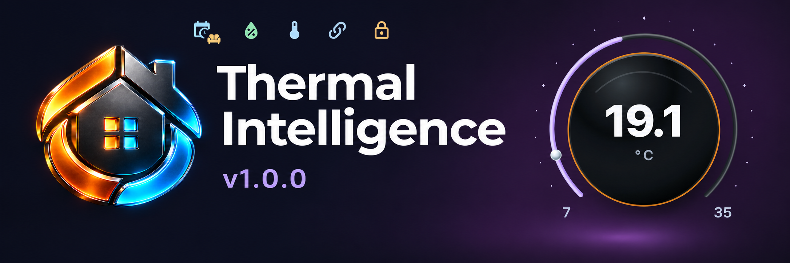

# Thermal Intelligence Wiki

## Start here

**Using the published RC.3 prerelease?** Its picker reads **Thermal Intelligence Thermostat · RC**. Follow the [RC.3 setup guide](https://github.com/senyo888/thermal-intelligence/blob/4caf6f84868079a4d8f25c5d5731654f015bc260/docs/card-configuration.md#visual-configuration) for that editor. For installation, use the [Marketplace instructions](https://github.com/senyo888/thermal-intelligence/blob/main/docs/marketplace.md) or [HACS guide](https://github.com/senyo888/thermal-intelligence/blob/main/docs/hacs.md).

## Set up your first room with 1.0.0

The prepared 1.0.0 card appears as **Thermal Intelligence Thermostat** in the picker. Start with one thermostat and follow the [first-room walkthrough](https://github.com/senyo888/thermal-intelligence/wiki/Configuration).

1. **Set up your room.** Select a climate entity and save. Expose [VT readings or your own sensors](https://github.com/senyo888/thermal-intelligence/wiki/Configuration#choose-your-sources), then [arrange the header](https://github.com/senyo888/thermal-intelligence/wiki/Configuration#arrange-the-top-row).
2. **Read the result.** Learn what the [arc, slope ring, status chip and LED](https://github.com/senyo888/thermal-intelligence/wiki/Reading-the-card) tell you. To enable the optional warming response, follow the [temperature response walkthrough](https://github.com/senyo888/thermal-intelligence/wiki/Configuration#set-up-temperature-response).

[See the Plum card, top-row layout and VT response setup in Senyo’s introduction to 1.0.0](https://github.com/senyo888/thermal-intelligence/blob/fe8414957fd490fa412eaa80920ecfe84f5e9561/docs/v1.0.0.md) · [Complete settings and YAML](https://github.com/senyo888/thermal-intelligence/blob/e6da5b4989140f58072b2f2e6059eea445b49b44/docs/card-configuration.md)

## Find your way

- [Thermal Intelligence in your home](https://github.com/senyo888/thermal-intelligence/wiki/Architecture-and-ownership) explains the sources, observations and control boundaries.
- [VT lock control](https://github.com/senyo888/thermal-intelligence/wiki/VT-lock-control) covers administrator actions and provider behaviour.
- [Marketplace](https://github.com/senyo888/thermal-intelligence/blob/main/docs/marketplace.md) covers Home Assistant 2026.11 and later; [HACS](https://github.com/senyo888/thermal-intelligence/blob/main/docs/hacs.md) covers older installations.
- [Troubleshooting](https://github.com/senyo888/thermal-intelligence/wiki/Troubleshooting) helps with resource loading, observations and rollback.

[Compatibility by version](https://github.com/senyo888/thermal-intelligence/wiki/Compatibility) covers the prepared 1.0.0 module and the published prereleases.

[Website](https://senyo888.github.io/thermal-intelligence/) · [Repository](https://github.com/senyo888/thermal-intelligence) · [Changelog](https://github.com/senyo888/thermal-intelligence/blob/main/CHANGELOG.md)
